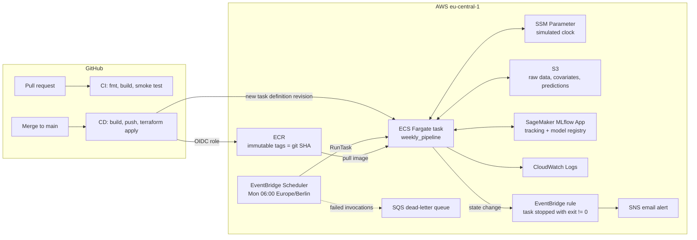
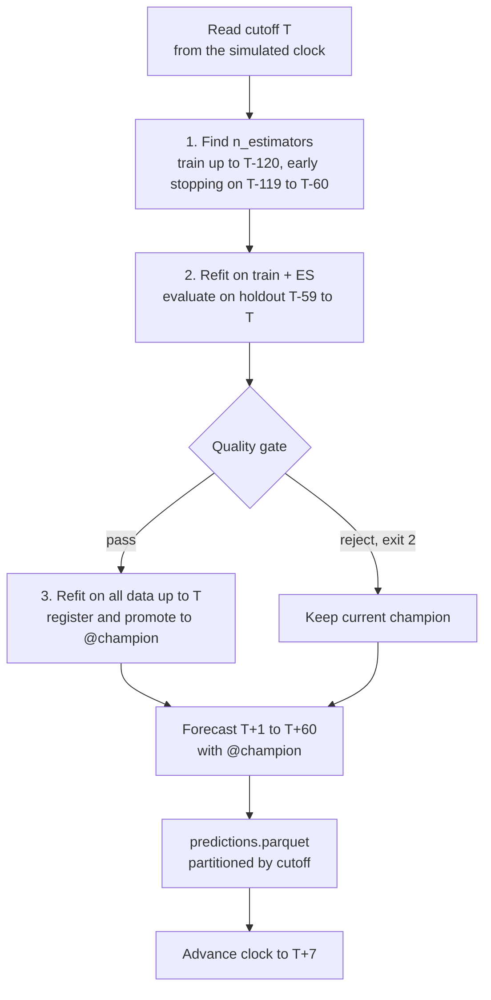
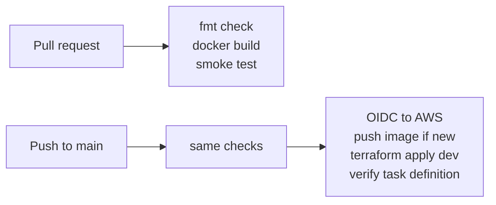

# Rossmann Sales Forecasting

An end-to-end forecasting system that predicts daily sales 60 days ahead for 1,115 Rossmann stores. It retrains, validates and forecasts every week on AWS, with no manual steps.

The data comes from the [Rossmann Store Sales](https://www.kaggle.com/c/rossmann-store-sales) Kaggle challenge. Here it is used as a realistic stand-in. **The focus of this project is not the leaderboard, but everything around the model:** leakage-free validation, an automated quality gate, a model registry, containerized batch jobs, infrastructure as code, CI/CD and monitoring.

## Highlights

- **Leakage-free validation by design.** Lags are always at least as long as the forecast horizon, every split is made *before* preprocessing, and stateful transforms (store clusters, schema) are fit per split.
- **Automated quality gate.** A retrained model is only promoted if it beats a seasonal naive baseline and does not regress against the current champion.
- **Weekly batch on AWS.** EventBridge Scheduler triggers an ECS Fargate task that retrains, gates and forecasts. Failures send an email.
- **Everything as code.** Terraform (state in HCP Terraform) for the infrastructure and GitHub Actions with OIDC for CI/CD. There are no long-lived AWS keys anywhere.
- **Simulated production clock.** The dataset ends in 2015, so a clock in SSM advances one week per run. The system "lives" through 18 weeks of history as if it were running in real time.

## Architecture



### What happens every Monday



If any step fails, the run exits with code 1, the clock does **not** advance (the next run retries the same week) and an email alert is sent.

## Modeling

| Aspect | Choice |
|---|---|
| Model | One global XGBoost model for all stores |
| Strategy | Direct multi-horizon forecast, H = 60 days |
| Lags | Same-weekday lags of at least H: 63, 70, 77, 84 days |
| Rolling features | 7 and 28-day windows over the series shifted by H |
| Store context | Store metadata plus KMeans clusters of store profiles, fit on training data only |
| Metric | sMAPE on open days (closed days are forecast as 0) |

**Why lags of at least 60 days?** At forecast time, the most recent known sale is at T. A 7-day lag for day T+30 would need sales from T+23, which do not exist yet. Using only lags of H or more makes training and inference see exactly the same information. A no-lookahead test checks this invariant.

**Why same-weekday lags?** Retail sales have a strong weekly pattern. A lag of 63 days (9 weeks) always lands on the same weekday as the target day.

### Validation and quality gate

Each retrain uses three time-ordered blocks, so the model that is evaluated is never trained on its own evaluation data:

| Step | Train on | Use |
|---|---|---|
| 1 | up to T-120 | Early stopping on T-119 to T-60 to find the number of trees |
| 2 | up to T-60 | Fixed number of trees, evaluated on the holdout T-59 to T |
| 3 | up to T | Final model, registered in MLflow |

The step 2 holdout score feeds the gate:

1. The candidate must beat a **seasonal naive** forecast on the same window by at least 10%.
2. The candidate may be at most 5% worse than the **current champion's** backtest.

If the gate rejects the candidate, the run still produces a forecast with the current champion and exits with code 2.

### Results

Realized error of a 60-day forecast made at cutoff 2015-01-30, evaluated against actual sales:

| Metric | Value |
|---|---|
| sMAPE (open days) | 10.2% |
| WAPE | 9.9% |
| Bias | +2.0% (slight under-forecast) |

The error stays flat across the 60-day horizon. A residual analysis by week, weekday, day of month, store and segment found the following:

- **Carnival** (week of 16 Feb 2015) is over-forecast.
- **Month-end** days are under-forecast. The raw data confirms that days 29 to 5 sell 10 to 20% above average.
- **The promo effect is exaggerated**: Wednesdays and Thursdays are over-forecast in promo weeks and under-forecast in non-promo weeks.
- **Larger stores are more under-forecast** than smaller ones (weighted bias 2.0% vs simple mean 1.5%).
- **Blind spot**: stores that grew recently are systematically under-forecast (r = 0.29, with a monotonic increase of bias across growth quintiles).

These findings drive the modeling backlog below.

### Earlier phases

- **Phase 1: Prophet.** One model per store segment. Interpretable, but it could not share patterns across stores, and a single global Prophet model performed poorly.
- **Phase 2: Global XGBoost.** Learns across all stores at once. It outperformed the segmented Prophet setup and became the production model.

## Infrastructure

| Component | Role | Key decisions |
|---|---|---|
| **ECR** | Container images | Immutable tags (git SHA), lifecycle keeps the last 5 images, scan on push |
| **ECS Fargate** | Runs the pipeline | 2 vCPU / 8 GB, no servers, no time limit. Default VPC, public IP, security group with no inbound rules |
| **IAM** | Permissions | Separate execution role (pull image, write logs) and task role (S3, MLflow, SSM), each scoped to its resources |
| **EventBridge Scheduler** | Trigger | Time zone aware (no DST drift), 2 retries, dead-letter queue for failed invocations |
| **EventBridge rule + SNS** | Alerting | Email when any task stops with a non-zero exit code |
| **S3** | Data | Raw sales, future covariates and predictions, partitioned by cutoff date |
| **SageMaker MLflow App** | Tracking and registry | Shared across projects. Models are served by the `@champion` alias, with cluster map and schema stored as artifacts of the same run |
| **SSM Parameter** | Simulated clock | Owned by the pipeline after creation (`ignore_changes` in Terraform) |
| **CloudWatch Logs** | Observability | 30-day retention. Every run ends with a `Weekly pipeline finished \| exit_code=N` line |

The Docker image went from **6.55 GB to 1.36 GB**: the uv cache moved to a BuildKit cache mount, a duplicated `chown` layer was removed, and `xgboost-cpu` replaced the CUDA build.

## CI/CD



- **No stored AWS keys.** GitHub assumes an IAM role through OIDC, and the role only trusts this repository's `dev` environment.
- **The image tag is the commit SHA.** The deployed version is always traceable to a commit, and rollback is a `git revert`.
- **Build once.** If the tag already exists in ECR, build and push are skipped.
- **Dependabot** keeps the GitHub Actions up to date, and the runner image is pinned.

## Repository structure

```
src/
  pipeline/          retrain, inference and weekly orchestration
  utils/             preprocessing, feature engineering, MLflow promotion, simulated clock
config/              per-environment configuration
infra/               Terraform: ECR, ECS, IAM, Scheduler, alerts, OIDC role
scripts/
  simulate_future.py   builds future covariates for a cutoff (dev only)
  backfill_future.py   builds covariates for every simulated week
  evaluate_forecast.py realized error of a past forecast
  ops/                 deploy.sh, run_task.sh, check_task.sh
.github/workflows/   CI/CD
notebooks/           exploration and residual analysis
```

## Running it

Local run (needs AWS credentials and `MLFLOW_TRACKING_URI` in `.env`):

```bash
uv sync
python -m src.pipeline.retrain_pipeline   --env dev --cutoff-date 2015-01-30
python -m src.pipeline.inference_pipeline --env dev --cutoff-date 2015-01-30
python -m src.pipeline.weekly_pipeline    --env dev --cutoff-date 2015-01-30
```

Exit codes: `0` success, `1` failure, `2` candidate rejected by the gate (forecast still produced).

On AWS:

```bash
scripts/ops/deploy.sh       # manual deploy (CI does this on merge to main)
scripts/ops/run_task.sh     # run the weekly pipeline now, following the logs
scripts/ops/check_task.sh   # wait for the task and show exit code, key log lines and clock
```

## Design decisions

| Decision | Why |
|---|---|
| Weekly batch instead of real-time serving | Forecasts are consumed weekly; an always-on endpoint adds cost and operations without benefit |
| ECS Fargate instead of Lambda | No 15-minute limit and enough memory for training |
| One ECR repository per environment | Clear separation of dev and prod images and permissions |
| Public subnet instead of NAT gateway | A NAT gateway costs more per month than the pipeline itself; the security group allows no inbound traffic |
| Terraform applies from CI with the tag as a variable | One source of truth: the deployed version is the commit on `main` |
| Managed MLflow instead of SageMaker training or endpoints | Registry and tracking are needed; managed training and endpoints are not, at this scale |

**Deliberately not used:** a feature store (only one model consumes the features), Kafka or Kinesis (no streaming data), Kubernetes (one weekly job does not justify a cluster), and Prefect or Airflow (one pipeline, already scheduled and monitored by AWS services).

## Known limitations

- **Holidays.** Carnival and Easter are not modeled explicitly and show the largest errors.
- **Silent failures.** The alert fires when a task fails, but not when no task runs at all. A "dead man's switch" alarm on the absence of the success log line would close this gap.
- **CI permissions.** The CI role can manage IAM roles with this project's prefix. A permissions boundary would limit what those roles can do.
- **Production.** Only `dev` is deployed. Production would add a Terraform plan on every PR and a manual approval before apply, and would promote the dev image instead of rebuilding it.

## Roadmap

**Monitoring**
- [ ] Evaluate past forecasts inside the weekly pipeline, so the realized error accumulates week by week

**Modeling**
- [ ] Day-of-month and days-to-month-end features
- [ ] Train on open days only
- [ ] Validate the promo effect, then add promo lag features
- [ ] Investigate extreme stores (closed days inside lag windows)
- [ ] Address the recent-growth blind spot

**Platform**
- [ ] Production environment with plan-on-PR and manual approval
- [ ] Dead man's switch alarm
- [ ] Predictions in PostgreSQL for downstream consumers
